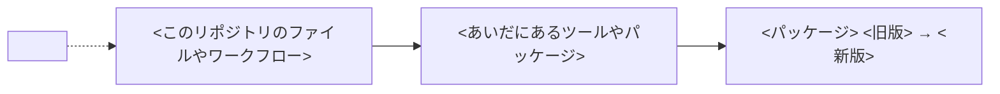

SKILL.md の手順 5 で PR に投稿するコメントの、書き方と本文の形。

- 専門用語は避けるか、初めて出たところで言い換える
- 図は Mermaid で書く
- 「どこで使われているか」の図は必ず入れる。このリポジトリのファイルやワークフローから、更新するパッケージまでのつながりと、それを動かした CI の検査を描く
- 変更の前後で動きが変わるときは、前後を比べる図も入れる
- 版の表は、対象の版が 2 つ以上あるときだけ入れる。1 つなら、影響は「何が変わったか」の文に書く
- グループの PR は、「何が変わったか」と「確認したこと」をパッケージごとに分ける。冒頭の 1 文には、更新するパッケージをすべて書く
- 脆弱性の修正を含む更新では、冒頭の 1 文でそう伝え、GHSA や CVE へのリンクも添える
- 「確認したこと」の結果は、問題なし・要判断・未確認のどれかにする

本文は次の形にし、`<...>` の箇所を埋める。

````markdown
## 依存更新の確認結果

**<パッケージ> を <旧版> から <新版> に更新する PR です。** <影響の有無を 1〜2 文で>

### 何が変わったか

<リリースノートの要約。このリポジトリの使い方に関わる変更を先に書く>

| 版 | おもな変更 | このリポジトリへの影響 |
| - | - | - |
| <版> | <変更> | <影響> |

### どこで使われているか



<図の説明を 1〜2 文で>

### 確認したこと

| 観点 | 結果 | 根拠 |
| - | - | - |
| 変更点と使い方の照合 | <結果> | <path:行番号など> |
| 版の記載 | <結果> | <README などに旧版の番号が残っているか> |
| CI | <結果> | <run の URL と、更新したものを動かしたかどうか> |
| ローカルでの実行 | <結果> | <実行したコマンドと結果。ツールがなく実行していなければ、そう書く> |
| main との差 | <結果> | <compare の結果> |
| 公開からの日数 | <結果> | <公開日時> |
| 配布物の検証 | <結果> | <provenance の有無と、integrity がロックファイルの値と一致するか> |

### 判断が必要なこと

<SKILL.md の手順 6 で聞くことと、推奨する対応とその理由。なければ「特になし」>

確認したコミット: <headRefOid>
````
