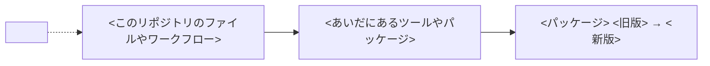

SKILL.md の手順 5 で PR に投稿するコメントの、書き方と本文の形。

- 専門用語は避けるか、初めて出たところで言い換える
- 「どこで使われているか」は、1〜2 文にまとめる。ツールや別のパッケージを通して使う間接の利用で、使われ方を文だけで伝えにくいときは、Mermaid の図も入れる
- 変更の前後で動きが変わるときは、前後を比べる図も入れる
- 版の表は、対象の版が 2 つ以上あるときだけ入れる。1 つなら、影響は「何が変わったか」の文に書く
- グループの PR は、「何が変わったか」と「確認したこと」をパッケージごとに分ける。冒頭の 1 文には、更新するパッケージをすべて書く
- 脆弱性の修正を含む更新では、冒頭の 1 文でそう伝え、GHSA や CVE へのリンクも添える
- 「確認したこと」の結果は、問題なし・要判断・未確認のどれかにする
- 根拠の欄は 1〜2 文とリンクにする。説明が長くなるときは、表の下に書く
- 参考リンクには、SKILL.md の冒頭にある、調べずに URL だけ載せる情報を並べる。当てはまるものがなければ、節ごと消す

本文は次の形にし、`<...>` の箇所を埋める。

````markdown
## 依存更新の確認結果

**<パッケージ> を <旧版> から <新版> に更新する PR です。** <影響の有無を 1〜2 文で>

### 何が変わったか

<リリースノートの要約。このリポジトリの使い方に関わる変更を先に書く>

| 版 | おもな変更 | このリポジトリへの影響 |
| - | - | - |
| <版> | <変更> | <影響> |

### どこで使われているか

<使われ方を 1〜2 文で。間接の利用で、文だけで伝えにくいときは次の図も入れる>



### 確認したこと

| 観点 | 結果 | 根拠 |
| - | - | - |
| 変更点と使い方の照合 | <結果> | <path:行番号など> |
| CI | <結果> | <run の URL と、新版が入って動いたことをログで確認したか> |

確認したコミット: <headRefOid>

### 参考リンク

<調べずに載せる URL を、何のリンクかと一緒に並べる>

### 判断が必要なこと

<SKILL.md の手順 6 で聞くことと、推奨する対応とその理由。なければ「特になし」>

### 決めたこと

<SKILL.md の手順 7 で追記する。最初に投稿するときは「まだ決めていません」と書く。書き換えるときは、前のコメントの内容を引き継ぐ>
````
